# 🧭 SƠ ĐỒ SITE MAP & USER FLOW — HANOI REALTY (BRAND TONE DESIGN)
**Dự án:** HaNoi Realty — Nền tảng Bất Động Sản & Bản đồ Quy hoạch Hà Nội (PropTech)  
**Ngày cập nhật:** 19/10/2026  
**Chuẩn thiết kế:** Đồng bộ 100% theo thứ tự thanh điều hướng Navbar thực tế và Tone màu thương hiệu (Deep Navy `#1a2744` & Vibrant Orange `#f97316`).

---

## 📌 PHẦN 1: SƠ ĐỒ SITE MAP (THEO THỨ TỰ THANH NAVBAR THỰC TẾ)

Cấu trúc cây thông tin được sắp xếp **lần lượt theo thứ tự từ trái sang phải** trên thanh Menu của website, bắt đầu từ nút gốc `Trang chủ` tỏa nhánh ra 10 phân hệ chính:

```
                                                                             [ 🏠 TRANG CHỦ ( / ) ]
                                                                                       │
     ┌──────────────┬──────────────┬──────────────┬──────────────┬──────────────┬──────┴──────┬──────────────┬──────────────┬──────────────┬──────────────┐
     │              │              │              │              │              │             │              │              │              │              │
[ 1. TÌM KIẾM ] [ 2. QUY HOẠCH] [ 3. TIN TỨC ] [ 4. BÁO CÁO AI] [ 5. BẢNG GIÁ ] [ 6. VỀ CHÚNG ] [ 7. ĐĂNG TIN ] [ 8. TÀI KHOẢN] [ 9. ADMIN    ] [ 10. SEO SILO]
[    BĐS      ] [    HÀ NỘI   ] [  THỊ TRƯỜNG] [   THẨM ĐỊNH ] [  & HỘI VIÊN  ] [    TÔI     ] [    BĐS     ] [  & DASHBOARD] [  (QUẢN TRỊ) ] [   & LOCAL   ]
  (Vibrant Cam)   (Deep Navy)     (Slate sẫm)    (Cam đất)       (Deep Navy)     (Slate sẫm)   (Cam nổi bật)   (Deep Navy)    (Đỏ Crimson)    (Hổ phách)
     │              │              │              │              │              │             │              │              │              │
     ├─ Bản đồ tra  ├─ Bản đồ quy  ├─ Tất cả tin  ├─ Báo cáo thị ├─ Gói hội viên├─ Giới thiệu ├─ Wizard đăng ├─ Bảng điều   ├─ Dashboard   ├─ Hub Mua bán
     │  cứu (/search)  hoạch 2030  │  tức (/news) │  trường BĐS  │  4 cấp bậc   │  HaNoi      │  tin 6 bước  │  khiển       │  tổng quan   │  SEO (/mua-
     ├─ Mua bán nhà │  (/planning) ├─ Thị trường  ├─ Định giá    │  (/pricing)  │  Realty     │  (/post-     │  (/dashboard)│  (/admin)    │  ban/...)
     │  đất (?type= ├─ Quy hoạch   │  BĐS (?cat=  │  nhà đất tự  ├─ Bảng giá    │  (/about)   │   property)  ├─ Thông báo hệ├─ Kiểm duyệt  ├─ Hub Cho
     │  sale)       │  phân khu    │   market)    │  động (/rep- │  đất Hà Nội  ├─ Đội ngũ    ├─ B1: Loại    │  thống       │  tin BĐS     │  thuê SEO
     ├─ Cho thuê    │  đô thị      ├─ Quy hoạch & │   orts)      │  mới nhất    │  chuyên gia │  BĐS & Nhu   │  (tab=notifi-│  (/admin/    │  (/cho-
     │  nhà đất     ├─ Kế hoạch    │  Hạ tầng     ├─ Dự báo xu   ├─ Lịch sử biến│  (#team)    │  cầu         │   cations)   │   listings)  │  thue/...)
     │  (?type=rent)│  sử dụng đất │  giao thông  │  hướng giá   │  động giá đất├─ Liên hệ hợp├─ B2: Định vị │  ⊞ Quản lý   ├─ Quản lý     ├─ Tuyến đường
     ├─ Dự án BĐS   ├─ Tra cứu theo│  Metro       │  24 tháng    │  theo quận   │  tác        │  GPS Leaflet │  tin đăng    │  người dùng  │  & Metro
     │  (?type=     │  tọa độ GPS  ├─ Biến động   ├─ Chi tiết báo├─ Checkout    │  (#contact) │  Map         │  (tab=listi- │  (/admin/    │  (/streets/
     │   project)   │  & VN-2000   │  giá đất mới │  cáo thẩm    │  thanh toán  └─ Điều khoản │  B3&B4: Thông│   ngs)       │   users)     │   [slug])
     └─ Bộ lọc đa   └─ So sánh     ├─ Chính sách &│  định AI     │  VNPay/MoMo  │  & Bảo mật  │  số, Giá &   ├─ ❤️ BĐS đã   ├─ Quản lý gói └─ Hub thông
        tiêu chí       trượt Swipe │  Pháp lý     │  (/reports/  └─ Kết quả giao└─ Bản quyền   │  Ảnh HD      │  lưu         │  & Coupon    │  tin quận
        (Giá, M2,      vệ tinh     └─ Chi tiết bài│   [id])         dịch & Hóa                 ├─ B5&B6: Xem  │  (tab=saved) │  (/admin/    │  huyện
        Hướng,                     │  viết (/news/└─ Xuất báo    │  đơn (/pay-                 │  trước & Ghim├─ 📅 Lịch hẹn  │   packages)  │  (/khu-vuc/
        Pháp lý)                   │   [id])         cáo PDF VIP │   ment/                     │  VIP         │  xem nhà     ├─ Quản lý     │   [slug])
                                                      chuẩn      │   success)                                 │  (tab=appoi- │  Thanh toán  └─ Sitemap &
                                                                                                              │   ntments)   │  (/admin/    │  Robots
                                                                                                              ├─ 🏷️ Nâng cấp │   payments)  │  XML
                                                                                                              │  gói & Quota ├─ Quản lý Quy └─ Chuẩn
                                                                                                              │  (tab=pack-  │  hoạch số       Google
                                                                                                              │   ages)      │  (/admin/       Index
                                                                                                              ├─ 🏢 Quản lý   │   planning)
                                                                                                              │  Agency Team └─ Thống kê
                                                                                                              │  (tab=agen-     analytics
                                                                                                              │   cy-team)
                                                                                                              └─ 🚪 Đăng xuất /
                                                                                                                 Đăng nhập
```

### 📋 Bảng đặc tả 10 phân hệ chuẩn hóa theo Navbar:

| Vị trí | Tên Phân Hệ | Đường dẫn | Tone màu Brand | Mô tả nghiệp vụ cốt lõi |
|---|---|---|---|---|
| **#1** | **Tìm kiếm BĐS** | `/search` | Vibrant Orange | • Bản đồ tra cứu chia đôi màn hình (Split-view)<br>• Mua bán nhà đất (`?type=sale`)<br>• Cho thuê nhà đất (`?type=rent`)<br>• Dự án khu đô thị (`?type=project`)<br>• Bộ lọc nâng cao: Giá, M2, Hướng, Pháp lý |
| **#2** | **Quy hoạch Hà Nội** | `/planning` | Deep Navy | • Bản đồ số Quy hoạch phân khu 2030–2045<br>• Lớp màu phân khu QCVN 01:2021 (ODT, TMD, HH, CX, GT)<br>• Kế hoạch sử dụng đất ranh giới 10 quận GeoJSON OSM<br>• Tra cứu tọa độ GPS & chuyển đổi kinh tuyến trục VN-2000<br>• So sánh trượt Swipe giữa bản đồ quy hoạch & vệ tinh |
| **#3** | **Tin tức thị trường** | `/news` | Dark Slate | • Tất cả tin tức thị trường BĐS Hà Nội<br>• Chuyên mục: Thị trường, Quy hoạch & Hạ tầng, Biến động giá đất, Chính sách & Pháp lý, Tài chính & Đầu tư<br>• Trang chi tiết bài viết dynamic route `/news/[id]` |
| **#4** | **Báo cáo thẩm định AI** | `/reports` | Warm Amber | • Phân tích định lượng BĐS tự động bằng Gemini 1.5 Pro<br>• Điểm tiềm năng đầu tư 0–100, ma trận SWOT<br>• Dự báo biên độ tăng giá 12–36 tháng<br>• Báo cáo chi tiết `/reports/[id]` & xuất file PDF chuyên nghiệp |
| **#5** | **Bảng giá & Hội viên** | `/pricing` | Deep Navy | • Bảng giá niêm yết 4 gói: Free, Basic, Pro, Agency (tiết kiệm đến 50% theo năm)<br>• So sánh chi tiết hạn mức & đặc quyền công nghệ các gói<br>• Cổng thanh toán Checkout VNPay QR/Thẻ, Ví MoMo<br>• Hóa đơn điện tử & nâng cấp hạn mức Quota tự động |
| **#6** | **Về chúng tôi** | `/about` | Dark Slate | • Giới thiệu nền tảng PropTech số 1 Hà Nội<br>• Đội ngũ chuyên gia dữ liệu thị trường & công nghệ GIS<br>• Kênh liên hệ hợp tác sàn BĐS & truyền thông<br>• Chính sách bảo mật & điều khoản sử dụng |
| **#7** | **Đăng tin BĐS (Nút cam)** | `/post-property` | Vibrant Orange | • Wizard đăng tin 6 bước trực quan<br>• Định vị tọa độ GPS chính xác qua bản đồ Leaflet<br>• Cấu hình thông số kỹ thuật, tải ảnh thực tế HD<br>• Xem trước & chọn ghim tin nổi bật VIP |
| **#8** | **Tài khoản & Dashboard** | `/dashboard` | Deep Navy | • Dropdown hồ sơ cá nhân: Cozy Hollys (Gói Free/Pro)<br>• 🔔 Trung tâm thông báo hệ thống (`tab=notifications`)<br>• ⊞ Quản lý tin đăng cá nhân (`tab=listings`)<br>• ❤️ BĐS yêu thích đã lưu (`tab=saved`)<br>• 📅 Quản lý lịch hẹn xem nhà (`tab=appointments`)<br>• 🏷️ 4 đồng hồ Quota hạn mức (`tab=packages`)<br>• 🏢 Quản lý đội ngũ sàn môi giới (`tab=agency-team`)<br>• 🚪 Đăng xuất / Đăng nhập / Đăng ký (`/login`, `/register`) |
| **#9** | **Quản trị Admin** | `/admin` | Crimson Red | • Dashboard tổng quan chỉ số vận hành nền tảng<br>• Kiểm duyệt tin đăng: Phê duyệt / Từ chối kèm lý do (`/admin/listings`)<br>• Quản lý người dùng & phân quyền (`user`, `broker`, `agency`, `admin`)<br>• Quản lý gói hội viên & mã coupon giảm giá (`/admin/packages`)<br>• Quản lý lịch sử giao dịch thanh toán (`/admin/payments`)<br>• Quản lý lớp dữ liệu quy hoạch số (`/admin/planning`)<br>• Báo cáo thống kê doanh thu & Retention (`/admin/analytics`) |
| **#10**| **SEO Silo & Địa phương** | `/mua-ban`<br>`/cho-thue`<br>`/streets` | Warm Amber | • Hub Mua bán BĐS chuẩn SEO Silo 4 tầng (`/mua-ban/[type]/[district]/[slug]`)<br>• Hub Cho thuê BĐS chuẩn SEO Silo (`/cho-thue/[type]/[district]/[slug]`)<br>• Tra cứu tuyến đường huyết mạch & nhà ga Metro (`/streets/[slug]`)<br>• Hub thông tin tổng quan quận huyện (`/khu-vuc/[slug]`)<br>• File chỉ mục tìm kiếm tự động `sitemap.xml` & `robots.txt` |

---

## 📌 PHẦN 2: SƠ ĐỒ USER FLOW TỔNG HỢP — SÀN XÁC MINH 3 BÊN (TONE BRAND HANOI REALTY)

Sơ đồ User Flow được thiết kế đồng bộ theo mô hình **Sàn BĐS Xác Minh 3 Bên** (Chủ nhà ký gửi — CTV môi giới khai thác — Người mua/thuê tiếp cận nguồn chuẩn — Admin điều phối & giữ cọc):

```mermaid
flowchart TD
    %% Entry Sources
    subgraph TrafficChannels ["Kênh tiếp cận đa kênh"]
        ch1["Quảng cáo / Google SEO / Bản đồ số<br><small>Google Search, Ads, Bản đồ quy hoạch</small>"]
        ch2["Trang chủ / Deep-link BĐS chi tiết<br><small>hanoirealty.vn, Link BĐS chuẩn đã thẩm định</small>"]
        ch3["Giới thiệu / Ref CTV / Mạng xã hội<br><small>Link chia sẻ ?ref=..., QR Code CTV</small>"]
    end

    gate["Khám phá Bản đồ số & Tin BĐS hoặc Đăng nhập"]
    ch1 --> gate
    ch2 --> gate
    ch3 --> gate

    %% 5 Roles
    gate --> R1["USER (Khách)"]
    gate --> R2["NGƯỜI MUA / THUÊ"]
    gate --> R3["CHỦ NHÀ BĐS"]
    gate --> R4["CTV / MÔI GIỚI"]
    gate --> R5["ADMIN / ĐIỀU PHỐI"]

    %% Flow 1: Khách vãng lai
    subgraph FlowUser ["1. Khách vãng lai (USER)"]
        u1["Trang chủ (/)<br><small>Hero search, BĐS VIP, tin quy hoạch</small>"]
        u2["Tìm kiếm / Bản đồ quy hoạch<br><small>/search, /planning (lọc giá, m2, quận)</small>"]
        u3["Xem chi tiết BĐS & Pháp lý<br><small>Xem ảnh thực tế, sổ đỏ trích lục, quy hoạch</small>"]
        u4{"Muốn thuê / mua?"}
        u5["Đăng ký tài khoản<br><small>Chọn vai trò: Khách hàng / Chủ nhà / CTV</small>"]
        u6["Trở thành Người mua/thuê"]
    end
    R1 --> u1 --> u2 --> u3 --> u4
    u4 -- "Có" --> u5 --> u6
    u4 -- "Không" --> u2

    %% Flow 2: Người mua / thuê
    subgraph FlowBuyer ["2. Người mua / Người thuê"]
        b1["Đăng nhập tài khoản<br><small>Hệ thống tự động nhận diện vai trò từ Supabase</small>"]
        b2["Tìm BĐS ưng ý & Tra cứu quy hoạch<br><small>Tra cứu phân khu 2030, bán kính Metro</small>"]
        b3["Đặt lịch xem nhà (Slot booking)<br><small>Chọn khung giờ xem nhà chống trùng lặp</small>"]
        b4["Nhận phản hồi lịch từ Chủ nhà / CTV<br><small>Thông báo xác nhận lịch hẹn tức thì</small>"]
        b5{"Ưng BĐS & Pháp lý?"}
        b6["Ký hợp đồng / Đặt cọc<br><small>Thỏa thuận đặt cọc bảo chứng qua sàn</small>"]
        b7["Thanh toán cọc / Phí sàn<br><small>Cổng thanh toán bảo an toàn giao dịch</small>"]
        b8(["🔴 KẾT THÚC"])
    end
    u6 -. "đăng ký xong" .-> b1
    R2 --> b1 --> b2 --> b3 --> b4 --> b5
    b5 -- "Có" --> b6 --> b7 --> b8
    b5 -- "Không" --> b2

    %% Flow 3: Chủ nhà BĐS
    subgraph FlowOwner ["3. Chủ nhà BĐS (Ký gửi nguồn)"]
        o1["Đăng ký tài khoản Chủ nhà<br><small>Cung cấp SĐT & loại BĐS ký gửi</small>"]
        o2{"Admin duyệt hồ sơ?"}
        o3["Tạo hồ sơ BĐS chuẩn (Canonical)<br><small>Khởi tạo dữ liệu nguồn gốc BĐS</small>"]
        o4["Đăng BĐS mới & Tải sổ đỏ<br><small>Tọa độ GPS PostGIS, sổ đỏ, ảnh thực tế</small>"]
        o5{"Duyệt / Từ chối?"}
        o6["Xác nhận lịch hẹn xem nhà<br><small>Duyệt yêu cầu dẫn khách từ Người mua & CTV</small>"]
        o7["Quản lý BĐS & Nhận cọc<br><small>Theo dõi tiến trình cọc & giao dịch</small>"]
        o8["Thanh toán phí sàn / Hoa hồng<br><small>Chi trả hoa hồng môi giới minh bạch</small>"]
        o9(["🔴 KẾT THÚC"])
    end
    R3 --> o1 --> o2
    o2 -- "Có" --> o3 --> o4 --> o5
    o2 -- "Bổ sung" --> o1
    o5 -- "Duyệt" --> o6 --> o7 --> o8 --> o9
    o5 -- "Sửa tin" --> o4

    %% Flow 4: CTV / Môi giới
    subgraph FlowAgent ["4. CTV / Môi giới (Khai thác kho mở)"]
        c1["Đăng ký CTV Môi giới<br><small>Chọn địa bàn hoạt động (13 quận huyện) & mô hình</small>"]
        c2["Tiếp cận Kho nguồn chuẩn mở<br><small>Tra cứu nguồn hàng độc quyền & hoa hồng</small>"]
        c3["Lấy link chia sẻ / Mã QR (?ref=)<br><small>Tạo link tiếp thị gắn ID CTV</small>"]
        c4["Đăng ký Lead Claim (Bảo hộ khách)<br><small>Bảo hộ khách hàng tiềm năng chống cướp khách</small>"]
        c5["Đặt lịch dẫn khách xem nhà<br><small>Kết nối với Chủ nhà để đón tiếp khách</small>"]
        c6["Hỗ trợ chốt cọc & Thỏa thuận<br><small>Đồng hành cùng khách mua và chủ nhà</small>"]
        c7["Nhận hoa hồng qua Ledger ví sàn<br><small>Tự động giải ngân hoa hồng khi giao dịch thành công</small>"]
        c8(["🔴 KẾT THÚC"])
    end
    R4 --> c1 --> c2 --> c3 --> c4 --> c5 --> c6 --> c7 --> c8

    %% Flow 5: Admin Hệ thống
    subgraph FlowAdmin ["5. Admin / Điều phối (HaNoi Realty)"]
        a1["Đăng nhập cổng Admin (/admin)<br><small>Tài khoản bảo mật cao cấp</small>"]
        a2["Dashboard kiểm duyệt & Thẩm định<br><small>Chỉ số BĐS mới, giao dịch, hoa hồng</small>"]
        a3["Thẩm định BĐS & Check trùng PostGIS<br><small>Xác minh sổ đỏ, khảo sát thực tế, chống trùng</small>"]
        a4["Duyệt đơn Chủ nhà & Lead Claim CTV<br><small>Phê duyệt bảo hộ khách hàng cho CTV</small>"]
        a5["Điều phối Slot lịch xem nhà<br><small>Kiểm soát khung giờ chống double-booking</small>"]
        a6["Khóa giao dịch & Giữ cọc an toàn<br><small>Bảo chứng cọc giữa Người mua & Chủ nhà</small>"]
        a7["Đối soát & Giải ngân hoa hồng<br><small>Hạch toán Ledger chia hoa hồng minh bạch</small>"]
        a8(["🔴 KẾT THÚC"])
    end
    R5 --> a1 --> a2 --> a3 --> a4 --> a5 --> a6 --> a7 --> a8

    %% Cross-Role Dashed Interactions
    b3 -. "đặt lịch" .-> o6
    b3 -. "đặt lịch" .-> c5
    o5 -. "thẩm định" .-> a3
    c4 -. "claim khách" .-> a4
    a7 -. "hoa hồng" .-> c7

    %% Bottom Conclusion
    b8 --> Final["Website có đủ dữ liệu thật và luồng vận hành khép kín (Chủ nhà — CTV Môi giới — Người mua/thuê — Admin)"]
    o9 --> Final
    c8 --> Final
    a8 --> Final

    %% Styling Classes
    classDef navyBox fill:#1a2744,stroke:#f97316,stroke-width:2px,color:#ffffff;
    classDef orangeBox fill:#fff7ed,stroke:#ea580c,stroke-width:2px,color:#9a3412;
    classDef emeraldBox fill:#ecfdf5,stroke:#0d9488,stroke-width:2px,color:#065f46;
    classDef blueBox fill:#f0f9ff,stroke:#0284c7,stroke-width:2px,color:#075985;
    classDef slateBox fill:#f8fafc,stroke:#334155,stroke-width:2px,color:#0f172a;
    classDef diamondBox fill:#fef3c7,stroke:#f59e0b,stroke-width:2px,color:#92400e;
    classDef finishRed fill:#ef4444,stroke:#b91c1c,stroke-width:2px,color:#ffffff;

    class gate,a1,a2 navyBox;
    class ch1,ch2,ch3,c1,c2,c3,c4,c5,c6,c7 orangeBox;
    class o1,o3,o4,o6,o7,o8 emeraldBox;
    class b1,b2,b3,b4,b6,b7 blueBox;
    class u1,u2,u3,u5,u6,a3,a4,a5,a6,a7,Final slateBox;
    class u4,b5,o2,o5 diamondBox;
    class b8,o9,c8,a8 finishRed;
```


